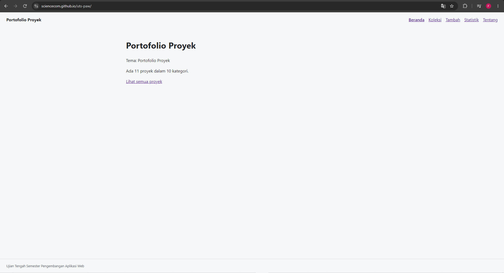
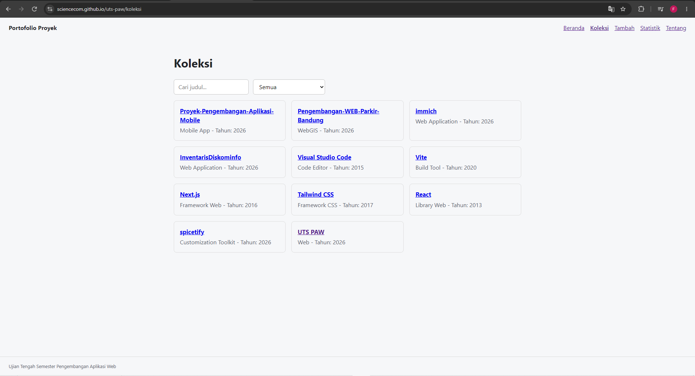
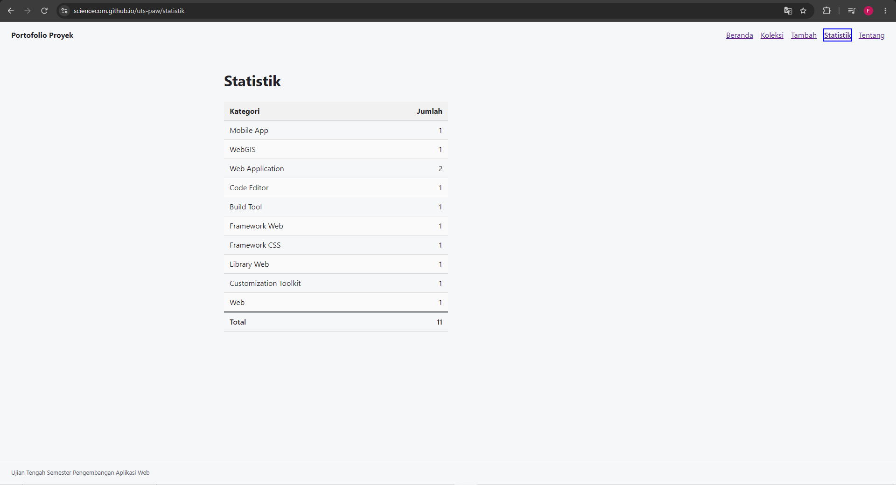
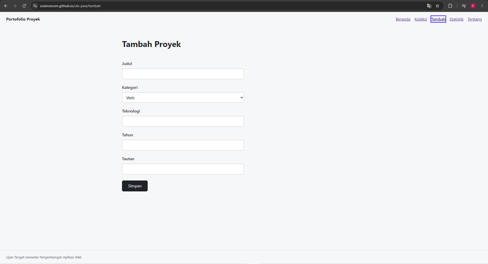
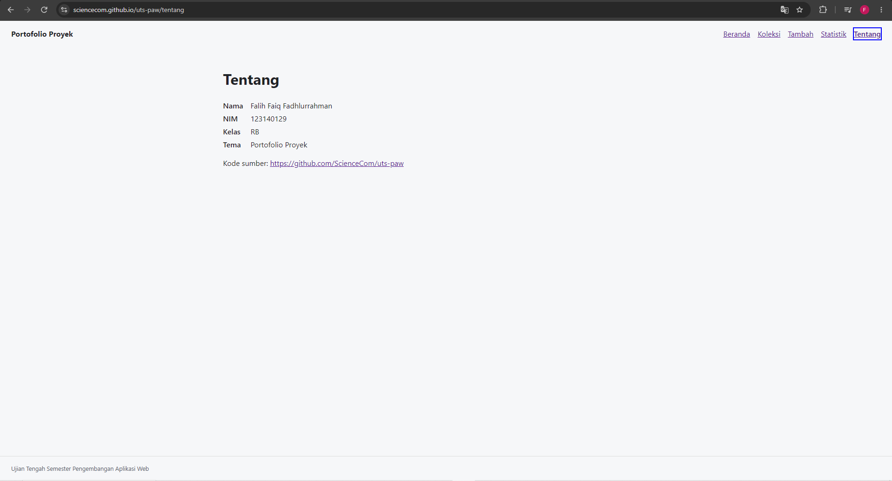
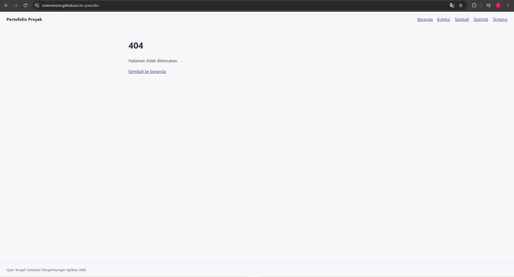

## Portofolio Proyek

Nama: Falih Faiq Fadhlurrahman

NIM: 123140129

Kelas: RB

Tema: Portofolio Proyek

Deployment: https://sciencecom.github.io/uts-paw/

## Fitur

1. Menampilkan daftar koleksi portofolio proyek.

2. Mencari proyek berdasarkan judul dan memfilter berdasarkan kategori.

3. Melihat detail proyek yang mencakup teknologi, tahun, dan tautan.

4. Menambahkan data proyek baru dengan validasi formulir.

5. Menghapus data proyek dari koleksi.

6. Melihat statistik jumlah proyek berdasarkan kategori dalam bentuk tabel.

7. Data tersimpan secara lokal menggunakan localStorage.

## Menjalankan secara lokal

cd app

npm install

npm run dev

## Konsep React yang dipakai

- Functional Components & Props: Pemisahan antarmuka menjadi komponen modular (seperti Navbar, KartuItem, KotakPencarian).

- Hooks (useState & useEffect): Mengelola state lokal (seperti input formulir) dan efek samping (seperti fetching data).

- Context API (createContext, useContext): Mengelola state global (data koleksi) yang dapat diakses oleh semua halaman tanpa prop drilling.

- Custom Hooks: Ekstraksi logika ke dalam useLocalStorage untuk penyimpanan lokal dan useKoleksi untuk konsumsi context.

- React Router: Navigasi Single Page Application (SPA) menggunakan Routes, Route, Link, NavLink, useParams, dan useNavigate.

## Tangkapan Layar
Berikut tampilan-tampilan dari fitur yang ada pada aplikasi. 

Beranda:

Koleksi:

Statistik:

Tambah:

Tentang:

Tidak Ditemukan:

